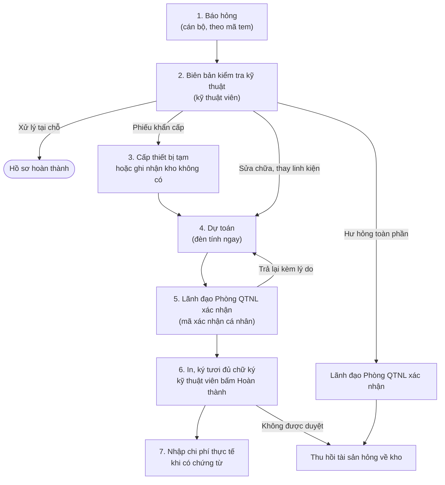

# SAM – Quản lý tài sản thông minh (Smart Asset Management)

Bản mẫu dự thi **ULIS Hackathon 2026**, đề tài do Phòng Kế hoạch - Tài chính, Trường Đại học Ngoại ngữ, ĐHQGHN đề xuất.

SAM là phần bổ sung cho phần mềm quản lý tài sản Trường đang dùng. SAM thêm phiếu báo hỏng trực tuyến, ghi chi phí sửa chữa, thay thế theo từng mã tài sản, và tự gán màu đèn cảnh báo cho mỗi tài sản. Màu đèn cho biết nên tiếp tục sửa, theo dõi sát, điều chuyển hay thanh lý.

Bản mẫu chạy độc lập, không kết nối với phần mềm quản lý tài sản đang vận hành. Kho mã nguồn không chứa dữ liệu thật của Trường.

## Bài toán

| Hiện nay | Với SAM |
|---|---|
| Báo hỏng qua điện thoại, tin nhắn, dễ trôi thông tin; người báo không biết phiếu đã xử lý đến đâu | Báo hỏng bằng mã tem trên máy tính hoặc điện thoại; kỹ thuật viên nhận thông báo đẩy ngay; người báo theo dõi được trạng thái phiếu |
| Phòng KHTC chỉ có số liệu trên sổ, không biết tài sản đã sửa mấy lần, tốn bao nhiêu | Mỗi mã tài sản có lịch sử báo hỏng, số lần và chi phí sửa; đèn tự cảnh báo khi chi phí chạm ngưỡng |
| Chi phí nằm chung trong hóa đơn gộp, che lấp "bẫy chi phí": tài sản sửa vượt ngưỡng (nhất là tài sản đã hết hao mòn) mà không ai phát hiện | Chi phí bóc tách theo từng mã; tài sản đã sửa quá tốn kém bị khóa phiếu dự toán, chỉ sửa tiếp khi có văn bản phê duyệt |

## Quy trình một hồ sơ sửa chữa



- Phiếu khẩn cấp phải làm bước 3 trước khi lập dự toán.
- Tài sản đang ở đèn Đỏ 1.1 hoặc Cam thì phiếu dự toán bị khóa. Kỹ thuật viên gửi kèm đề nghị ngoại lệ, in cùng phiếu dự toán để trình ký.
- Người báo hỏng nhận thông báo khi phiếu được tiếp nhận và khi hồ sơ hoàn thành.

## Hệ thống đèn cảnh báo

Ngưỡng mặc định (20%, 30%, 3 lần, 2 lần, 12 tháng, 40%) do Phòng KHTC đặt lại được trên phần mềm. Từ 2 lần sửa chữa trong năm, tài sản được gắn thêm nhãn "Sửa chữa lặp lại" để theo dõi.

| Đèn | Khi nào | Tác động |
|---|---|---|
| 🔴 Đỏ 1.1 | Đã hết hao mòn và chi phí sửa trong năm ≥ 20% nguyên giá; hoặc hư hỏng toàn phần đã xác nhận | Khóa phiếu dự toán, vào danh sách chờ thanh lý, cho phép đề nghị ngoại lệ |
| 🔴 Đỏ 1.2 | Chưa hết hao mòn, hư hỏng toàn phần hoặc bất khả kháng đã xác nhận | Vào danh sách chờ thanh lý |
| 🟠 Cam | Chưa hết hao mòn, sửa ≥ 3 lần/năm hoặc chi phí trong năm > 30% nguyên giá | Tạm dừng sửa, kiểm tra kỹ thuật, bảo hành; khóa phiếu dự toán |
| 🟡 Vàng 3.1 | Nằm kho 12 tháng liên tục không có tương tác | Rà soát, điều chuyển |
| 🟡 Vàng 3.2 | Đã hết hao mòn, có sửa trong năm, chi phí < 20% nguyên giá | Nhãn "Theo dõi sát" |
| 🟡 Vàng 3.3 | Chi phí cộng dồn từ khi dùng SAM ≥ 40% nguyên giá | Nhãn "Sửa chữa kéo dài", rà soát khi lập kế hoạch mua sắm |
| 🟢 Xanh lá | Đã hết hao mòn, trong năm không sửa chữa | Nhãn "Tài sản vượt vòng đời" |
| 🔵 Xanh dương | Chưa hết hao mòn, vận hành bình thường | Không cảnh báo |

Trong phần mềm có trang **Giải thích đèn** trình bày đầy đủ điều kiện theo ngưỡng đang đặt.

## Vai trò người dùng

Mỗi cán bộ, giảng viên có một tài khoản cá nhân do Phòng KHTC cấp. Thao tác có giá trị xác nhận (xác nhận dự toán, duyệt đề xuất, gửi danh sách thanh lý…) phải nhập mã xác nhận cá nhân.

| Vai trò | Việc chính |
|---|---|
| Cán bộ, giảng viên | Báo hỏng, theo dõi phiếu của mình (không xem màu đèn) |
| Cán bộ đầu mối đơn vị | Xem tài sản toàn trường theo màu đèn (7 cột, không có chi phí), tải Excel, PDF; lập đề xuất xử lý cho tài sản đơn vị mình |
| Kỹ thuật viên Phòng QTNL | Tiếp nhận phiếu, lập biên bản, cấp thiết bị tạm, lập dự toán, nhập chi phí thực tế, đề nghị thu hồi |
| Lãnh đạo Phòng QTNL | Xác nhận hoặc trả lại dự toán, biên bản hư hỏng toàn phần; duyệt đề xuất xử lý tài sản |
| Phòng KHTC (quản trị) | Nhập dữ liệu tài sản, cán bộ; cấp tài khoản, mã xác nhận; đặt ngưỡng; đối chiếu chi phí; xác nhận thu hồi; tổng hợp đề xuất trình Ban Giám hiệu |

## Tính năng chính

- **Báo hỏng:** gõ mã tem, tên tài sản hoặc phòng; báo nhiều tài sản một lần (mỗi tài sản một phiếu, chung mã đợt); chọn nội dung, tình huống từ danh mục có sẵn; cảnh báo khi tài sản đang có phiếu chưa xử lý xong.
- **Hàng chờ:** phiếu khẩn cấp lên đầu, phiếu cùng đợt đứng cạnh nhau, nhận cả đợt bằng một nút; gộp phiếu trùng một sự cố.
- **Dự toán:** nội dung đề xuất của biên bản điền sẵn thành các dòng dự toán; xem trước màu đèn sẽ đổi ra sao trước khi gửi; tự lưu bản nháp; thẻ "Bị trả lại", "Chưa gửi lãnh đạo", "Chờ in và ký", "Chờ chi phí thực tế".
- **Biểu mẫu in điền sẵn:** phiếu báo hỏng, biên bản kiểm tra, phiếu điều chuyển tạm thời, phiếu dự toán, phiếu đề nghị ngoại lệ, biên bản giao nhận; in hoặc tải Word.
- **Thẻ tài sản:** bảng tài sản gắn màu đèn và cột Đề xuất; lọc theo màu đèn, đơn vị, nhóm tài sản; tải Excel đúng danh sách đang lọc (ví dụ danh sách Đỏ 1.1); xem lý lịch từng tài sản.
- **Đề xuất xử lý tài sản:** thanh lý, điều chuyển, thay thế; lãnh đạo Phòng QTNL duyệt hoặc giao kỹ thuật xem xét; không duyệt bắt buộc ghi lý do.
- **Thu hồi tài sản hỏng về kho:** đề nghị thu hồi, Phòng KHTC xác nhận, biên bản giao nhận, nhập điều chuyển chính thức.
- **Tổng quan tài sản:** số tài sản theo màu đèn, chi phí sửa chữa trong năm, danh sách chờ thanh lý, tài sản tốn kém nhất, các lần kho không có thiết bị thay thế.
- **Thông báo đẩy:** Web Push qua trình duyệt, không cần cài ứng dụng, không tốn phí; bấm thông báo mở đúng phiếu; màn hình đang mở tự cập nhật khi có việc mới.
- **Dùng trên điện thoại:** cán bộ báo hỏng ngay tại phòng học. Kỹ thuật viên nhận phiếu, cấp thiết bị tạm khi khẩn cấp (chọn nhanh thiết bị cùng loại đang ở kho), lập biên bản kiểm tra và chụp ảnh biên bản đã ký ngay tại phòng; các nút cần bấm nằm ở thanh dưới cùng màn hình.
- **Đăng nhập:** Access Token 15 phút trong bộ nhớ, Refresh Token trong cookie HttpOnly; đổi mật khẩu bắt buộc ở lần đăng nhập đầu; Phòng KHTC khóa tài khoản hoặc đặt lại mật khẩu là đăng xuất người đó trên mọi thiết bị.

## Công nghệ

| Phần | Công nghệ |
|---|---|
| Máy chủ (`be_sam/`) | Python 3.12, FastAPI, SQLAlchemy 2 (bất đồng bộ), Alembic, MySQL 8.0 hoặc MariaDB 10.11, pywebpush |
| Giao diện (`fe_sam/`) | React 19 (Create React App), Tailwind CSS 3, Recharts, lucide-react, docx (tải biểu mẫu Word) |
| Triển khai | Dockerfile và `start.sh` cho từng phần; nginx phục vụ giao diện và chuyển `/api` về máy chủ |

## Cấu trúc thư mục

```
SAM/
├── be_sam/            Máy chủ FastAPI
│   ├── api/v1/        Các API (tiền tố /api/v1, xem đủ ở /docs)
│   ├── services/      Nghiệp vụ: báo hỏng → dự toán, tính đèn, thu hồi, đề xuất, nhập Excel, thông báo đẩy
│   ├── models/        Bảng cơ sở dữ liệu (SQLAlchemy)
│   ├── alembic/       Các bản cấu trúc bảng (0001 → 0005), tự nâng cấp khi khởi động
│   ├── tests/         Kiểm thử pytest
│   └── .env.example   Mẫu cấu hình
└── fe_sam/            Giao diện React
    ├── src/pages/     Các màn hình (Hàng chờ, Hồ sơ phiếu, Dự toán, Thẻ tài sản, Tổng quan…)
    ├── src/components/
    ├── src/utils/     Gọi API, tính đèn phía giao diện, biểu mẫu in, xuất Excel
    └── public/        Service worker (sw.js), manifest cho thông báo đẩy
```

## Chạy trên máy

Cần Python 3.12, Node.js 22 và một máy chủ MySQL hoặc MariaDB.

**1. Máy chủ** (http://localhost:8000/docs)

```bash
cd be_sam
python -m venv venv && source venv/bin/activate     # Windows: .\venv\Scripts\Activate.ps1
pip install -r requirements.txt
cp .env.example .env                                 # điền MYSQL_*, ADMIN_PASSWORD
python run.py
```

Mỗi lần khởi động, máy chủ tự tạo cơ sở dữ liệu nếu chưa có và nâng cấp cấu trúc bảng (`alembic upgrade head`). Lần đầu, máy chủ còn tạo tài khoản quản trị của Phòng KHTC (`ADMIN_USERNAME`, `ADMIN_PASSWORD`), ngưỡng đèn mặc định và danh mục báo hỏng mẫu.

**2. Giao diện** (http://localhost:3000)

```bash
cd fe_sam
npm ci
npm start                    # gọi API qua proxy tới http://localhost:8000
npm run build                # bản triển khai trong fe_sam/build
```

**3. Bắt đầu dùng:** đăng nhập bằng tài khoản quản trị, vào **Tài sản → Nhập Excel** để nhập nhóm tài sản và danh sách tài sản, nhập dữ liệu cán bộ. Sau đó cấp tài khoản cá nhân và mã xác nhận ở trang **Tài khoản, mã xác nhận**.

**Chạy bằng Docker:** chạy `bash start.sh` trong `be_sam/` trước (cổng 127.0.0.1:8530), rồi `bash start.sh` trong `fe_sam/` (cổng 8531). Chi tiết cấu hình MySQL ngoài container ở `be_sam/README.md`.

Thông báo đẩy cần trang chạy HTTPS (localhost được coi là an toàn khi chạy thử). Trên iPhone cần iOS 16.4 trở lên và thêm SAM vào Màn hình chính.

## Kiểm thử

```bash
# Máy chủ: 58 kiểm thử, dùng cơ sở dữ liệu riêng sam_test (xóa, tạo lại mỗi lần chạy)
cd be_sam
TEST_MYSQL_USER=... TEST_MYSQL_PASSWORD=... python -m pytest -q

# Giao diện: 29 kiểm thử
cd fe_sam
npm test -- --watchAll=false
```

## Dữ liệu và bảo mật

- Kho mã nguồn không chứa dữ liệu thật của Trường, tệp `.env`, khóa bí mật (`be_sam/data/`) hay tệp đính kèm (`be_sam/uploads/`); các mục này đã có trong `.gitignore`.
- Dữ liệu trong `be_sam/tests/fixtures/` và `fe_sam/src/utils/__fixtures__/` là dữ liệu mẫu chỉ dùng cho kiểm thử.
- Link sản phẩm mẫu công khai chỉ dùng dữ liệu giả lập.
- Khi triển khai thật: giữ thư mục `be_sam/data/` (hoặc đặt `JWT_SECRET`, `CODE_SECRET` trong `.env`) và sao lưu `be_sam/uploads/` cùng cơ sở dữ liệu.

## Tài liệu thêm

- `be_sam/README.md`: cấu hình, danh sách API, cấu trúc bảng, nhập Excel, chạy bằng Docker.
- `fe_sam/README.md`: màn hình, biểu mẫu in, thông báo đẩy, cấu trúc giao diện.

---

Đội thi SAM – Phòng Kế hoạch - Tài chính, Trường Đại học Ngoại ngữ, ĐHQGHN.
